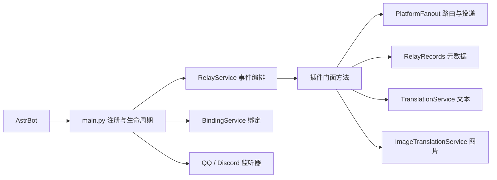

# MineAstr 0.8.1 插件开发说明 / Developer guide

目标为 AstrBot >=4.16,<5，WebSocket 协议号为 1。`metadata.yaml` 与 `main.py` 注册版本保持 0.8.1，配套 MC 模组仍为 0.8。

## 从哪里开始 / Reading map

`main.py` 保留 AstrBot 扫描的命令、事件、工具签名和装饰器，管理初始化与卸载。业务实现通过组合服务调用，每个插件实例拥有自己的组件。新增业务应放进对应服务；入口只做参数转交和生命周期协调。

The facade preserves framework registration and owns lifecycle coordination. Domain services belong to one plugin instance. Add behavior to its responsible service rather than growing the entry class.

| 文件 / File | 职责与状态 / Responsibility and state |
| --- | --- |
| `main.py` | 注册入口、初始化、卸载、适配器接线 / registration, lifecycle and adapter wiring |
| `mineastr_components.py` | 实例组件创建及旧字段到状态所有者的显式映射 / component construction and explicit field ownership |
| `mineastr_settings.py` | 配置读取、分组迁移和保存 / settings access, migration and saving |
| `mineastr_defaults.py` | 默认值、配置分组及模板；共享活动会话索引 / defaults, groups, templates and active-session index |
| `mineastr_plugin_runtime.py` | AstrBot/MCP 兼容导入、诊断日志 / compatibility imports and diagnostics |
| `mineastr_bindings.py` | 绑定、验证码、快照同步锁及按服务器登记的后台任务 / bindings, codes, snapshot lock and per-server tasks |
| `aqqbot_compat.py` | SQLite 事务、旧数据兼容、过滤及格式化工具 / persistence, compatibility, filtering and formatting |
| `mineastr_translation.py` | 文本翻译、模型回退、上下文与术语提供器 / text translation, fallback, context and glossary provider |
| `mineastr_image_translation.py` | 多模态翻译、总超时预算与图片译文缓存 / image translation, deadlines and image-result cache |
| `mineastr_glossary.py` | 独立术语索引、相关词条召回与文件重载 / glossary indexing, retrieval and reload |
| `mineastr_relay.py` | 游戏、平台及机器人事件编排 / game, platform and bot-event orchestration |
| `mineastr_fanout.py` | 会话路由、共享翻译与并行平台投递 / session routing, shared translation and concurrent delivery |
| `mineastr_relay_records.py` | 已转发消息元数据、引用识别、过期和容量约束 / relay metadata, reply recognition and bounded retention |
| `mineastr_notifications.py` | 平台通知配置、本地化模板和死亡原因 / profiles, localized notifications and death reasons |
| `mineastr_qq.py` | QQ 监听器、退群解绑和群名片 / QQ listeners, leave-group unbinding and cards |
| `mineastr_discord.py` | Discord 监听器及重试、昵称、编辑和撤回 / Discord listeners, retries, nicknames, edits and deletions |
| `mineastr_commands.py` | 命令处理、管理员同步与审批展示 / commands, administrator sync and approvals |
| `mineastr_plugin_tools.py` | LLM 工具参数、权限检查及适配器请求 / LLM tool inputs, permissions and adapter requests |
| `mineastr_screenshots.py` | 截图请求、并发冷却及后台保存 / requests, cooldowns and worker persistence |
| `mineastr_cache.py` | 清理任务、跨所有者缓存维护与截图文件保留 / maintenance task, cache pruning and screenshot retention |
| `mineastr_plugin_media.py` | 消息链、引用和游戏图片载荷 / message chains, replies and game media payloads |
| `mineastr_media.py` | QQ/Discord 原始图片元数据和消息内附件去重；不下载媒体 / raw image metadata and per-message attachment identity without downloads |
| `mineastr_image_optimizer.py` | 下载去重、预览、压缩和后台缓存 / download deduplication, previews, compression and worker caches |
| `minecraft_adapter.py` | 连接与查询管理、协议接收、签名图片 HTTP / connections, query futures, protocol receiving and signed media |
| `__init__.py` | 插件包标识 / package identity |
| `_conf_schema.json` | AstrBot 配置页面 / settings schema |
| `scripts/package_plugin.py` | 可重复安装 ZIP 的完整运行文件清单 / deterministic archive and runtime manifest |

## 调用与状态归属 / Calls and ownership

跨组件调用显式经过插件门面；服务直接读写自己的状态。`ServiceField` 将兼容字段映射到唯一所有者，维护任务清理的是同一容器，没有第二份缓存。组件构造只建立内存状态，不启动任务、不执行 I/O；需要资源的初始化仍在插件生命周期入口完成。不要增加通用 `__getattr__` 或把新业务复制回入口类。

Cross-component calls use explicit facade methods. Services mutate their own state, and compatibility descriptors refer to the same containers used by maintenance. Constructors perform no I/O or task scheduling. Resource setup remains in the plugin lifecycle.

`main.py` 保留旧符号导出以兼容集成；测试替换过滤器或容量常量时，替换实际使用它们的服务模块。命令、事件和工具的框架装饰器仍只出现在注册入口，异步生成器继续逐项转交结果。

## 并发与持久化约束 / Concurrency and persistence

1. 原文投递、共享翻译和游戏回传保持并行；过滤后文本变化时使用独立翻译缓存作用域。单个平台失败不阻塞其他目标。
2. WebSocket 收包不等待慢通知或模型。图片解码、SQLite 和文件操作在线程中执行；签名预览不等待完整媒体准备。
3. 绑定快照在锁内读取当前数据库，远端成功后才视为同步成功；同一服务器的重复调度复用任务。授权不读取展示名称缓存。
4. 缓存和冷却使用各自既有的时间基准；图片翻译的首次请求及修正共享总截止时间，不因模型回退重置预算。
5. `terminate` 取消并等待清理、绑定及 Discord 重试任务，再移除平台监听器及适配器回调。新增任务必须加入已有的生命周期回收路径。
6. 图片只在当前消息内按已知附件标识、URL 和最终缓存路径去重，不跨消息吞掉重复图片。任意站点的查询参数仍保留语义；Discord 原始附件优先于缩放代理。下载优化后再次去重，文字投递不等待图片。

Keep receiving, original delivery and translation independent. Read current binding snapshots under the synchronization lock. Preserve deadline and clock semantics. Cancel and await owned tasks before detaching callbacks during unload.

## 验证与打包 / Validation and packaging

- `python -m pytest -q`：231 项测试、112 项子测试通过，包含消息内图片去重、HTTP/GIF 动画处理、实例隔离、跨组件清理、异步生成器和卸载回收。平台发送由测试捕获，不向真实 QQ/Discord 群发图。
- `python -m ruff check --select E9,F63,F7,F82 .`：关键错误检查通过。
- `python scripts/package_plugin.py <output.zip>`：生成完整安装包。新增运行模块时更新 `PACKAGE_FILES`；归档测试检查包括函数内延迟导入在内的依赖。

0.8 拆分迁移的 182 个业务方法经过 AST 对照，除组件访问路径和文档外，方法体保持等价；0.8.1 另行修复图片去重行为。单元测试与本地构建不等于生产 TPS 验证。NeoForge 的线程及性能约束见配套工程的 `docs/MAINTENANCE.md`。
